# Synthetic Data Augmentation in the Extreme-Imbalance Regime: A Dose-Response Study and a Missing-Baseline Reassessment

**Authors:** Aditya Puttaparthi Tirumala ¹, Meghasyam Tummalacherla ² and Varun Varma Sangaraju ³

¹ Independent Researcher and Principal Data Scientist, USA  
² [Affiliation to be added]  
³ Independent Researcher and Senior Engineer, USA

**Corresponding author:** [to be confirmed]

## Abstract

Practitioners facing severe class imbalance, such as email conversion rates below 1%, often turn to synthetic data augmentation. Existing benchmarks do not say whether augmentation helps at a given positive rate and sample size. We report a controlled study of six datasets (seven configurations, with Nomao in a full and a sparse version) spanning 0.3% to 30% positive rate, five generators (GaussianCopula, CTGAN, SMOTE, TabDDPM, and GReaT), four classifier families, and 5 to 10 seeds. Two dose-response experiments hold the total sample size fixed and vary only the number of minority-class examples, separating scarcity from dataset identity. On the two marketing datasets, Hillstrom (0.9% positive) and Criteo (0.3%), augmentation raised mean AUC by 5.7 to 12.9 points, although the 5-seed paired intervals include zero. On the four control datasets, at 11.7% to 30% positive rate, no generator gained more than 0.27 AUC points. CTGAN's conditional sampler produced minority rows at 7 to 89 times the natural rate on the marketing datasets, while unconditional TabDDPM and GaussianCopula gained less. On Criteo, 7 of 10 multi-layer perceptron (MLP) seeds failed to converge on real data alone, and CTGAN augmentation restored convergence in all 10. The harmful range depends on the dataset. On Bank Marketing augmentation became significantly harmful above about 1% positive rate, but on Nomao the effect was much smaller. ADASYN, a free method, tied CTGAN on both marketing datasets in paired t-tests (p = 0.97 and 0.21), and SMOTE tied as well. CTGAN training was not reproducible in the standard SDV implementation, as refitting on identical data and seed swung AUC by over 10 points. Below about 1% positive rate we recommend trying ADASYN or SMOTE before CTGAN. Above 10%, augmentation is unlikely to help. In between, our two datasets disagree, so practitioners should validate on their own data.

**Keywords:** synthetic data augmentation; class imbalance; CTGAN; ADASYN; SMOTE; dose-response; tabular classification; marketing analytics

---

## 1. Introduction

Marketing and product data scientists routinely face classification problems with severe class imbalance. Email conversion rates fall below 1%, display ad click-through rates go below 0.5%, and rare events occur across many customer cohorts [1,2]. The class imbalance problem itself is well studied [3–5]. A growing body of work proposes synthetic data augmentation as a remedy [6,7]. The approach trains a generative model on the available real data, uses it to generate synthetic examples, and then combines them with the real data to improve downstream classifier performance. The available generators have multiplied quickly, from interpolation-based oversampling methods such as SMOTE (Synthetic Minority Over-sampling Technique), ADASYN (Adaptive Synthetic Sampling), Borderline-SMOTE and Geometric SMOTE [8], through conditional generative adversarial networks (GANs) such as CTGAN (Conditional Tabular GAN) and CTAB-GAN+ [9], copula-based parametric models, diffusion models such as TabDDPM (tabular denoising diffusion probabilistic model), TabSyn and TabDiff [10], and language-model-based synthesizers such as GReaT (Generation of Realistic Tabular data), TabuLa [11], TabMT [12] and REaLTabFormer [13].

This expansion has not brought matching clarity for practitioners. Existing benchmarks [14–16] evaluate generators across heterogeneous tabular tasks and report aggregate rankings that do not answer the practitioner's actual question: given my classification task at a certain positive rate and sample size, which generator should I use, and will augmentation help at all?

This paper extends the broader benchmark literature, including the closest study at the target venue. Won et al. [17], published in Electronics, compare SMOTE, GaussianCopula, TVAE (tabular variational autoencoder) and CTGAN on a single banking dataset, UCI Bank Marketing, which has a 7.88:1 ratio of majority to minority examples, or about 11.3% positive. They compare the generators on statistical fidelity and machine learning utility and report a weak negative correlation between the two. Their limitations section identifies six gaps, and this paper addresses five of them through dataset breadth, generator coverage, and dose-response methodology. Won et al. also measured how closely the synthetic data matches the real data, using marginal similarity, correlation preservation and Kolmogorov-Smirnov (KS) tests, and asked whether that statistical realism predicts downstream utility. We do not repeat that analysis, because our question is different: under what conditions does augmentation help, and why? We measure one fidelity quantity that bears on this question, the share of positive rows in the synthetic data (Section 2.4.2), and list the omission as a limitation in Section 4.7.

We address the five gaps as follows.

1. Dataset breadth. Won et al. noted that "the evaluation was conducted on a single dataset from the banking domain." We evaluate six datasets spanning telecom, finance, lead generation, and real marketing and advertising.
2. Generator coverage. They noted that "diffusion-based models (TabDDPM, TabSyn) and LLM-based generation (GReaT)... were not included." We include TabDDPM and GReaT at two large language model (LLM) scales, GPT-2 and Mistral-7B.
3. Classifier coverage. They noted that "three traditional machine learning classifiers... inclusion of deep neural network classifiers would broaden the assessment." We add a multi-layer perceptron (MLP), a neural network, as a fourth classifier family.
4. Metrics. They noted that "formal PR-AUC computation... were not performed." We report Average Precision throughout.
5. Imbalance range. They noted that "all experiments were conducted at a single imbalance ratio (7.88:1)" and called for "systematic evaluation across a range of imbalance ratios... would reveal how the relative effectiveness of augmentation methods changes" [17]. We test positive rates from 0.3% to 30%. We also run two dose-response experiments. A dose-response design varies one input in steps and records how the outcome changes. Here we hold the total sample size fixed at 10,000 and vary only the number of minority-class examples, which separates minority count from dataset identity.

The sixth gap, hyperparameter optimization for deep generative models, is also a genuine boundary of this study, since we use library defaults throughout. On the adjacent question of which hyperparameter matters most, we test TabDDPM with a fivefold increase in training budget and find that performance degrades rather than improves, which rules out undertraining as the explanation for its weaker results. We also sweep the synthetic-to-real mixing ratio α, the number of synthetic rows added as a fraction of the real training rows, across every generator. This dimension is not on the future-work list of Won et al. [17]. The sweep establishes a practical rule that holds regardless of generator choice: use a mixing ratio α between 0.1 and 0.3, never 1.0.

One result previews why the practitioner-facing question matters. On Criteo Display Advertising at a 0.3% positive rate, 7 of 10 MLP seeds failed to converge on real data alone and predicted the majority class every time. After CTGAN augmentation, all 10 seeds converged. In this regime augmentation is the difference between a working classifier and a broken one.

This paper does not propose a new generative method. It confirms that resampling helps when minority examples are absolutely rare, whatever the relative imbalance, which is consistent with the imbalanced-learning literature dating to the early 2000s. Its contribution is the same kind that Won et al. [17] claim: a systematic, integrated comparison at a scale and with a rigor not previously available for this practitioner question. It adds two findings that neither Won et al. nor the broader benchmark literature provide, a controlled separation of minority count from dataset identity and a missing-baseline check that overturns the assumption that a more sophisticated generator should win.

Our contributions are:

1. A characterization of when augmentation helps across six datasets and four classifier families, extending the single-dataset design of Won et al. [17].
2. A dose-response design that separates minority-class count from dataset identity, replicated on two datasets. To our knowledge it is the first within-dataset test of this question.
3. A missing-baseline check that changes the practical recommendation: ADASYN and SMOTE statistically tie CTGAN on both marketing datasets.
4. A disclosed reliability finding: CTGAN's fit-to-fit randomness is uncontrolled in the standard SDV implementation and produces swings in the area under the receiver operating characteristic curve (AUC) as large as the augmentation gains we report. We believe this has not been reported before.
5. A direct comparison of TabDDPM and CTGAN at two training budgets. Extended training widens the gap, which points to an architectural cause (unconditional versus conditional sampling) and argues against undertraining.

Section 2 describes datasets, experimental setup, generator implementations, and evaluation metrics. Section 3 reports results. Section 4 discusses mechanism, fidelity-utility trade-offs, and practical implications. Section 5 concludes.

---

## 2. Materials and Methods

### 2.1. Dataset Description

We selected six publicly available classification datasets spanning the practitioner-relevant range of positive rates, from 0.3% to 30%, as summarized in Table 1. Nomao appears twice, as a full version and as a sparse version with 70% of its feature values removed, so Table 1 lists seven configurations. Four datasets serve as controls, with positive rates of 11.7% or higher, and two as the treatment condition, with positive rates of 0.9% or lower, drawn from real marketing operations. The sparse Nomao configuration is a stress test. Where the text says Nomao without qualification, it means the full version.

**Table 1. Dataset characteristics.**

| Dataset | Rows used | Positive rate | Domain | Source | Role |
|---|---|---|---|---|---|
| Telco Customer Churn | 7,032 | 26.6% | Telecom | IBM Kaggle | Control |
| Bank Marketing | 15,000 | 11.7% | Finance | UCI [18] | Control |
| German Credit | 1,000 | 30.0% | Finance | OpenML id=31 [19] | Control |
| Nomao Lead (full) | 10,000 | 28.3% | Lead generation | OpenML id=1486 [20] | Control |
| Nomao Lead (sparse, 70% missing) | 500 | 28.3% | Lead generation | OpenML id=1486 [20] | Sparsity stress |
| **Hillstrom Email Marketing** | **10,000** | **0.9%** | **Marketing** | MineThatData [21] | **Treatment** |
| **Criteo Display Advertising** | **10,000** | **0.3%** | **Advertising** | Criteo AI Lab [22] | **Treatment** |

Datasets with more rows than the listed value are randomly subsampled to it. The cap is 10,000 rows for Nomao and the two marketing datasets and 15,000 rows for Bank Marketing, and it defines the data-scarce minority-class regime this paper studies. At full scale the marginal value of synthetic rows is expected to be smaller (Section 4.7). The Telco Customer Churn control shares its domain with recent applied work that combines SMOTE and GAN-based augmentation for churn prediction [23]. Two supplementary sources provide additional headroom for the dose-response design in Section 2.2.5: the full UCI Bank Marketing data, with 45,211 rows and 5,289 positives (11.7% positive), and the full OpenML Nomao data, with 34,465 rows and 9,844 positives (28.6% positive, against 28.3% in the 10,000-row sample of Table 1).

### 2.2. Experimental Setup

#### 2.2.1. Compute Environment

Benchmark and confidence-interval experiments were run on an Apple M1 Pro CPU. TabDDPM and GReaT experiments were run on Databricks GPU clusters, using NVIDIA T4 or A10G GPUs for TabDDPM and GPT-2 GReaT and an H100 with bf16 precision for Mistral-7B GReaT. Total compute was approximately 60 GPU-hours and 80 CPU-hours for the original experiments, plus about 15 CPU-hours for the dose-response and missing-baseline extensions reported here. GaussianCopula and CTGAN are implemented with the Synthetic Data Vault (SDV) v1.36, SMOTE, ADASYN, Borderline-SMOTE and random undersampling with imbalanced-learn v0.12, TabDDPM with synthcity v0.2.11, and GReaT with be-great v0.0.13. Classifiers are implemented with scikit-learn.

#### 2.2.2. Repeated Experiments and Statistical Analysis

All augmentation results use 5 seeds {42, 123, 7, 2024, 999}, with 95% confidence intervals (CIs) computed from the t-distribution on per-seed values. A value written as mean ± x is the mean with the half-width of its 95% CI, unless stated otherwise. The multi-classifier robustness analysis extends to 10 seeds by adding {10, 20, 30, 40, 50}. Unless stated otherwise, every p-value in this paper comes from a two-sided paired t-test over seeds that compares an augmented run with the baseline run of the same seed. We apply Benjamini-Hochberg false discovery rate (FDR) correction at q = 0.10 over the family of 14 headline tests and write p_fdr for the FDR-adjusted p-value. Effect sizes are Cohen's d_z, the mean of the paired differences divided by their standard deviation. The sole exception is the TSTR protocol (Section 3.1), which is reported as a single-seed point estimate to match the prior work it is compared against [4].

#### 2.2.3. Data Preprocessing

Categorical features are label-encoded for GaussianCopula and entity-embedded for CTGAN [24]. Numeric features are used as-is for tree-based classifiers. Missing values in Nomao are imputed with column medians where required. The `duration` feature is dropped from Bank Marketing because it leaks the target.

#### 2.2.4. Data Splitting Strategy

An 80/20 stratified train/test split is used for all main experiments. For the GReaT experiments with small training sets, from n=50 to n=2,000 rows, a fixed 10,000-row holdout drawn with seed 42 is used across all training sizes and seeds, because a variable split would leave too few positive test examples at n=50. For the dose-response experiments (Section 2.2.5), a fixed holdout of 3,000 rows, stratified at the dataset's natural rate, is drawn once and reused across every minority-count condition, so holdout composition never varies within a dataset.

#### 2.2.5. Synthetic Data Generation Protocol

**Notation.** Let $D = (X, y)$ denote a labeled dataset with $y \in \lbrace 0,1 \rbrace$, $N = |D|$ the total row count, and $m = \sum_i y_i$ the minority (positive-class) count, so the positive rate is $\pi = m/N$. For a generator $G_\theta$ fit on training split $D_{tr}$, let $S \sim G_\theta(\cdot \mid D_{tr}, n_{syn})$ denote $n_{syn}$ synthetic rows sampled from the fitted generator. The augmented training set at mixing ratio $\alpha$ is

$$D_{tr}^{(\alpha)} = D_{tr} \cup S, \qquad n_{syn} = \lfloor \alpha \cdot |D_{tr}| \rfloor, \qquad \alpha \in \lbrace 0.1, 0.2, 0.3, 0.5, 1.0 \rbrace.$$

For a classifier $f$ trained on $D_{tr}^{(\alpha)}$ and evaluated on a fixed real holdout $D_{ho}$, the **per-seed gain** of generator $G$ at mixing ratio $\alpha$ and seed $s$ is

$$\Delta_G(\alpha, s) = \mathrm{AUC}\big(f_{D_{tr}^{(\alpha)}, s},\ D_{ho}\big) - \mathrm{AUC}\big(f_{D_{tr}, s},\ D_{ho}\big).$$

Each per-seed gain is therefore measured against the same seed's own real-only baseline, never a blended or cross-seed baseline. We report the mean gain $\bar\Delta_G(\alpha) = \tfrac{1}{|S|}\sum_{s \in S} \Delta_G(\alpha, s)$, which averages the per-seed gains over seeds $S$, with a t-distribution 95% CI across seeds, and take $\alpha^{\ast} = \arg\max_\alpha \bar\Delta_G(\alpha)$ as the reported best $\alpha$. Gains are reported in AUC points, meaning AUC multiplied by 100, so one point is 0.01 AUC.

**Enrichment ratio.** Let $\hat\pi_{syn}(G) = \tfrac{1}{n_{syn}}\sum_{j} I(y^{syn}_j = 1)$ be the measured positive rate within a generator's own synthetic output at $\alpha=1$ (Table 2), where $y^{syn}_j$ is the class label of synthetic row $j$ and $I(\cdot)$ is the indicator function, equal to 1 when its condition holds and 0 otherwise. The enrichment ratio

$$\rho(G) = \hat\pi_{syn}(G) \ /\  \pi$$

is the core mechanism statistic of this paper. It is measured directly from the generated rows. It is close to 1 for GaussianCopula and TabDDPM, which sample unconditionally and reproduce the training distribution's own rate, while for CTGAN it lies between 7 and 89 across the two marketing datasets (Table 2). GReaT also samples unconditionally, so we expect a ratio near 1, but we did not measure it.

For each (dataset, generator, seed) triple we generate synthetic rows at α ∈ {0.1, 0.2, 0.3, 0.5, 1.0}. GaussianCopula and CTGAN are refit independently at each α, with no fit-once-and-subsample caching in this implementation. SMOTE, ADASYN and Borderline-SMOTE are called again at each α because they have no separate fit step. TabDDPM fits once at the largest α and subsamples for smaller values. GReaT fits once per training size n and seed, generates one set of rows equal to the α=1 amount, and subsamples that set for smaller α.

**Dose-response design.** As defined in Section 1, a dose-response design varies one input in steps and records how the outcome changes. Here the input is the minority-class count $m$. To separate $m$ from dataset identity, we fix $N=10{,}000$ and vary only $m \in \lbrace 16, 64, 256, 512, 1{,}024 \rbrace$, which corresponds to positive rates of 0.16%, 0.64%, 2.56%, 5.12% and 10.24%. We use two datasets chosen for headroom beyond their capped versions in Table 1. Bank Marketing has a full source of 45,211 rows and 5,289 positives. Nomao has a full source of 34,465 rows and 9,844 positives, and was chosen additionally for its different domain and higher dimensionality, 119 features against 17. GaussianCopula, CTGAN and SMOTE are evaluated at each level. TabDDPM and GReaT are excluded from this sweep to keep it CPU-only. Algorithm 1 gives the full procedure.

**Algorithm 1: Minority-Count Dose-Response Sweep**

```
Input:  full source pool P (positives P⁺, negatives P⁻), N = 10,000,
        minority-count grid M = {16, 64, 256, 512, 1024},
        seeds S = {42, 123, 7, 2024, 999}, generators G = {GaussianCopula, CTGAN, SMOTE}
Output: gain estimate Δ̄_G(m) with 95% CI, for every G ∈ G, m ∈ M

1:  D_ho ← StratifiedSample(P, size=3000, seed=42)        // drawn ONCE, fixed for all conditions
2:  P' ← P \ D_ho                                          // remaining pool after holdout removal
3:  for m in M:
4:      n_neg ← N − m
5:      for s in S:
6:          D_tr ← Shuffle( Sample(P'⁺, m, seed=s) ∪ Sample(P'⁻, n_neg, seed=s) )
7:          f_base ← Fit(GradientBoostingClassifier, D_tr, seed=s)
8:          AUC_base ← AUC(f_base, D_ho)
9:          for G in G:
10:             S_syn ← Fit-and-Sample(G, D_tr, n_syn = |D_tr|, seed=s)   // α = 1.0
11:             D_aug ← D_tr ∪ S_syn
12:             f_aug ← Fit(GradientBoostingClassifier, D_aug, seed=s)
13:             Δ_G(m, s) ← AUC(f_aug, D_ho) − AUC_base     // seed-matched, never cross-seed
14:         end for
15:     end for
16:     for G in G: report mean_s Δ_G(m, s) ± t-CI95         // Table 6 / Figures 11–13
17: end for
```

Two features make this design answer the confounding critique it was built for (Section 1). The first is line 1, where one holdout is reused unchanged across every $m$ and $G$, so no condition ever sees a different evaluation surface. The second is line 13, where each generator's per-seed gain is always computed against that exact seed's own baseline fit on the same draw, never a baseline averaged or borrowed from elsewhere.

#### 2.2.6. Experimental Workflow

For each (dataset, generator, seed) combination we run four steps: a baseline trained and tested on real data only, a train-on-synthetic, test-on-real (TSTR) run that trains on synthetic data only and tests on real data, the augmentation sweep across α, and, for Hillstrom and Criteo only, a 10-seed, four-classifier robustness extension.

#### 2.2.7. Evaluation Protocol

Splits are stratified on the target. To control seed-induced non-determinism, all experiments call a `seed_everything()` routine that seeds Python `random`, NumPy, PyTorch on CPU and CUDA, and the cuDNN deterministic flag. There is one documented exception. The CTGAN-calling code in this implementation seeds NumPy but never PyTorch, which we identify and quantify as a limitation in Section 4.5.

### 2.3. Synthetic Data Generation Methods

The generators evaluated span five design families: interpolation-based oversampling (SMOTE, ADASYN and Borderline-SMOTE), GaussianCopula, CTGAN, TabDDPM, and GReaT.

#### 2.3.1. Interpolation-Based Oversampling

**SMOTE** [25] generates synthetic minority examples by linear interpolation between a minority example $x_i$ and one of its $k$-nearest minority neighbors $x_{nn}$:

$$x_{new} = x_i + \lambda \cdot (x_{nn} - x_i), \qquad \lambda \sim \mathcal{U}(0,1).$$

It has no separate fit step and operates only on the minority class. **ADASYN** [26] extends this by weighting each minority example $x_i$ by the local density of majority neighbors,

$$r_i = \frac{1}{k}\Big|\lbrace x_j \in kNN(x_i) : y_j = 0 \rbrace\Big|, \qquad \hat{r}_i = r_i \ \Big/\  \sum_{i'} r_{i'},$$

then generates $g_i = \mathrm{round}(\hat{r}_i \cdot n_{syn})$ synthetic points at $x_i$, with the count rounded to the nearest integer, using the same interpolation rule as SMOTE, so examples in harder-to-learn regions, those surrounded by more majority examples, receive proportionally more synthetic neighbors. **Borderline-SMOTE** [27] applies the identical interpolation formula but restricts the base points $x_i$ to minority examples classified as "in danger", meaning a majority of their $k$ nearest neighbors belong to the majority class. All three are free, needing no GPU and no training step beyond nearest-neighbor search, and are evaluated at the same α sweep as the deep generative methods.

#### 2.3.2. Gaussian Copula

**GaussianCopula** [28] models the joint cumulative distribution function (CDF) of the available $d$ features via a copula $C$ applied to fitted per-feature marginals $F_1, \dots, F_d$:

$$F(x_1, \dots, x_d) = C\big(F_1(x_1), \dots, F_d(x_d)\big), \qquad C = \Phi_\Sigma\big(\Phi^{-1}(F_1(x_1)), \dots, \Phi^{-1}(F_d(x_d))\big),$$

where $\Phi_\Sigma$ is the multivariate Gaussian CDF with correlation matrix $\Sigma$ estimated from the rank-transformed training data, and $\Phi$ is the standard normal CDF. Sampling draws directly from this fitted joint distribution $F(x_1, \dots, x_d)$. No class-label conditioning enters the generative process, so it samples at the natural class rate regardless of $\alpha$ (Section 3.2, Table 2).

#### 2.3.3. CTGAN

**CTGAN** [29] is a conditional generative adversarial network [30] trained with the standard minimax objective

$$\min_G \max_D\  \mathbb{E}_{x \sim p_{data}}\big[\log D(x \mid c)\big] + \mathbb{E}_{z \sim p_z}\big[\log\big(1 - D(G(z, c) \mid c)\big)\big],$$

The conditional vector $c$ encodes a target discrete-column value drawn during training by training-by-sampling. At each step, $c$ is drawn with log-frequency weighting across that column's categories rather than at the natural class rate, so the generator learns to condition on the minority class and can be asked to target it at inference time. GaussianCopula and the unconditional formulation of TabDDPM lack this mechanism. It produces the 7 to 89 times minority-class enrichment that we measure directly in Table 2.

#### 2.3.4. TabDDPM and GReaT

**TabDDPM** [31,32] applies a Gaussian forward diffusion process [33] to continuous features,

$$q(x_t \mid x_{t-1}) = \mathcal{N}\big(x_t;\ \sqrt{1-\beta_t}\  x_{t-1},\ \beta_t I\big),$$

with an analogous multinomial diffusion process for categorical columns, and trains a network $\epsilon_\theta$ to reverse it. Sampling proceeds by iterative denoising from $x_T \sim \mathcal{N}(0, I)$ back to $x_0$. TabDDPM is reported as the strongest single-table generator on general augmentation benchmarks [15], but its reverse process samples unconditionally over the joint feature-label distribution. No class-conditioning term enters the objective of $\epsilon_\theta$, which is the same structural limitation as GaussianCopula through a different generative mechanism. **GReaT** [34] serializes each tabular row as a natural-language string and fine-tunes a pretrained causal language model, GPT-2 with 117M parameters or Mistral-7B with 7B parameters, using the standard autoregressive objective $\mathcal{L} = -\sum_t \log p_\theta(w_t \mid w_{<t})$ over the serialized token sequence. Its sampling is likewise unconditional on the label unless explicitly prompted, and the default `guided_sampling` configuration used here does not enforce class-balanced generation.

#### 2.3.5. Non-Generative Baselines

**Random majority undersampling** removes majority-class rows to reach a target class ratio, evaluated here at 1:1, and adds no synthetic data at all. **`class_weight='balanced'`** reweights the training loss so that each class counts equally. In the two-class case every example gets a weight of $n/(2n_c)$, where $n$ is the number of training rows and $n_c$ is the size of its class, so each minority example weighs more than each majority example. The data are unchanged, the cost is negligible, and the effective class ratio seen by the loss becomes 1:1. It is implemented with `sample_weight=compute_sample_weight('balanced', y_train)`. Both are included because simple resampling and cost-sensitive baselines are the standard comparators that a synthetic generator should beat before it is recommended [47–51].

### 2.4. Evaluation Metrics

#### 2.4.1. Classification Utility

The primary metric is the area under the receiver operating characteristic curve (AUC-ROC), which is threshold-independent and standard in the benchmark literature this paper compares against. Secondary metrics are Average Precision (AP) throughout and, on every dataset except the sparse stress test, Accuracy, Precision, Recall and F1 for the minority class at the classifier's default 0.5 threshold. These are computed for every method that was run on each dataset except GReaT, which is scoped out of the secondary-metric set for the reason given in Section 4.7. Threshold-based metrics are known to be less stable than AUC-ROC under extreme class imbalance with few minority holdout examples [3,35]. The primary downstream classifier is `GradientBoostingClassifier` [36] with `n_estimators=100` and `max_depth=4`, implemented in scikit-learn [37]. Hillstrom and Criteo additionally use Logistic Regression, Random Forest and an MLP to verify that the findings are not classifier-specific.

#### 2.4.2. Synthetic Data Class Distribution as a Fidelity Proxy

We do not run a full multi-dimensional statistical fidelity battery of the kind in Section 3.4.1 of Won et al. [17], covering marginal similarity, correlation preservation and KS tests. Instead we measure one targeted quantity that bears directly on the imbalanced-classification question: the fraction of positive-class rows in synthetic samples generated at α=1.0 (Table 2). This tests the mechanism hypothesis, that conditional generators enrich the minority class and unconditional generators do not, without needing the broader framework, which we leave to future work (Section 4.7).

---

## 3. Results

### 3.1. Synthetic-Only Training Underperforms Real Data (TSTR)

Training on synthetic data alone and testing on real data (TSTR) gives the cleanest measure of how faithfully a generator captures the joint distribution. Across three control datasets, every generator's TSTR AUC falls materially below the real-data baseline. Even for GaussianCopula, the closest generator, the shortfall relative to baseline is 4.1% on Telco, 17.4% on Bank Marketing and 27.2% on German Credit. The gap is largest on the smallest dataset, German Credit, and no generator closes it. Synthetic data can augment real data but cannot replace it.

### 3.2. Class Distribution After Augmentation

**Table 2. Synthetic positive rate by generator on Hillstrom and Criteo. Values are 5-seed mean ± std for GaussianCopula, CTGAN and SMOTE, and a single run for TabDDPM, which is not independently re-verifiable.**

| Generator | Hillstrom | Criteo |
|---|---|---|
| Real training data | 0.90% | 0.30% |
| GaussianCopula | 0.96% ± 0.12% | 0.32% ± 0.06% |
| **CTGAN** | **6.65% ± 0.41%** | **26.78% ± 1.19%** |
| SMOTE | 100% (minority only) | 100% (minority only) |
| TabDDPM | 0.89% ± 0.05% | 0.33% ± 0.09% |

GaussianCopula and TabDDPM both mirror the natural, rare positive rate. They sample unconditionally and leave the minority class no better represented than in the real data. In these two marketing datasets, CTGAN's conditional vector generates minority rows at 7 to 89 times the natural rate. This table shows the mechanism directly, without inference from downstream performance.

### 3.3. Classification Performance

**Control datasets, with positive rates of 10% or more.** The best gain from any generator at any α stays below +0.5 AUC points, at +0.21 on Telco, −0.17 on Bank Marketing, +0.27 on German Credit and −0.06 on Nomao. All of these lie within the 95% CI of the baseline (Figures 1 and 2).

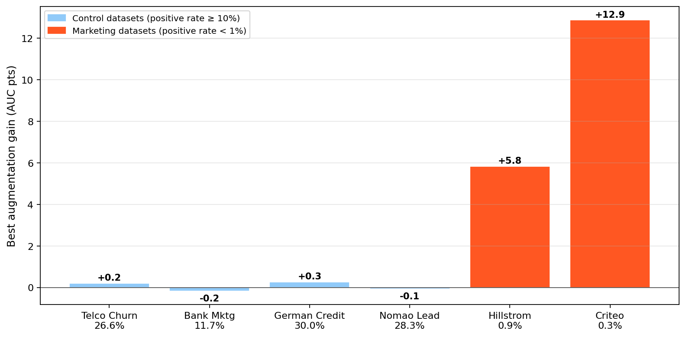

**Figure 1.** Cross-dataset summary. Augmentation gains concentrate on the two marketing datasets, and all generators are within the 95% CI of the baseline on the four control datasets. This is the clearest visual answer to which range shows value and which does not.

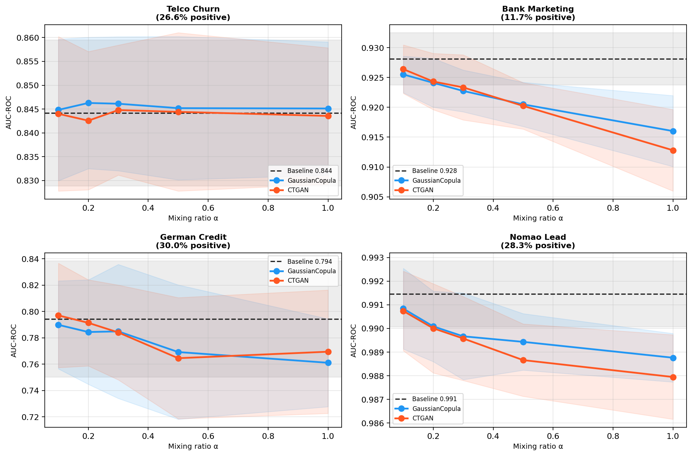

**Figure 2.** U-shaped augmentation curves for the four control datasets. Gains peak at α between 0.1 and 0.3 and degrade toward α=1.0 on every dataset, but stay within the 95% CI of the baseline throughout. Section 4.3 discusses the α* choice this motivates.

**Does the AUC-only conclusion survive a full metric suite?** The result above for the control datasets uses AUC-ROC only. We extend the same 5-seed, best-α protocol to Accuracy, Precision, Recall and F1 on all four control datasets (Table 3) to check whether the threshold-independence of AUC masks a real shift in operating point.

**Table 3. Full metric suite on the control datasets, best-α gain against the seed-matched baseline. Each gain is the augmented run at the best α minus the baseline run of the same seed, averaged over 5 seeds. AUC and accuracy gains are in points (×100), and F1, precision and recall gains are in raw units. The p-values are raw paired t-test p-values. Bold marks values that stay significant after FDR correction over the 24 tests of the full 12-row table, which are AUC and F1 for each of the 12 dataset and generator pairs.**

| Dataset | Method (α*) | AUC gain (pts) | p(AUC) | F1 gain | p(F1) | Precision gain | Recall gain | Accuracy gain (pts) |
|---|---|---|---|---|---|---|---|---|
| Telco | SMOTE (0.1) | −0.19 pts | 0.394 | +0.0175 | 0.038 | −0.037 | +0.057 | −0.70 |
| Bank Marketing | GaussianCopula (0.2) | −0.15 pts | 0.171 | **−0.0417** | **0.009** | +0.007 | −0.056 | −0.21 |
| Bank Marketing | CTGAN (0.1) | **−0.28 pts** | **0.006** | −0.0261 | 0.026 | +0.002 | −0.035 | −0.16 |
| Bank Marketing | SMOTE (0.1) | −0.43 pts | 0.036 | **+0.0599** | **0.008** | −0.053 | +0.128 | −0.32 |
| German Credit | SMOTE (0.2) | +0.28 pts | 0.692 | +0.0154 | 0.257 | −0.058 | +0.063 | −1.20 |
| Nomao | CTGAN (0.1) | −0.06 pts | 0.042 | −0.0000 | 0.991 | −0.001 | +0.001 | −0.01 |

*GaussianCopula and CTGAN rows for Telco and German Credit, and GaussianCopula and SMOTE rows for Nomao, are omitted from this condensed table because all are non-significant, with gains within ±0.5 AUC points, which is ±0.005 AUC, and ±0.03 F1 of zero. The full 12-row table is in the companion analysis document. Bold values survive Benjamini-Hochberg FDR correction at q=0.10 within this table's own family of 24 tests, which is separate from the family of 14 in Section 3.5. Nomao numbers come from a rerun at n=10,000, matching Table 1.*

Three comparisons are FDR-significant, but every one is tiny in absolute terms, at most 0.28 AUC points and 0.06 F1 points. They are detectable only because these control datasets have unusually tight per-seed variance, which is consistent with a negligible effect that is occasionally detectable in direction. The one exception worth practical attention is the F1 gain of SMOTE on Bank Marketing, which is +0.060 and FDR-significant, and, more weakly, on Telco, where it is +0.018 and uncorrected. On Bank Marketing, SMOTE raises recall by 0.128, from 0.412 to 0.539, and lowers precision by 0.053, from 0.631 to 0.578. This precision-recall trade-off does not show up in AUC-ROC, because AUC-ROC does not depend on the decision threshold or the class prior. GaussianCopula and CTGAN show no such effect, and their F1 moves in the opposite direction if anything. Nomao is the cleanest no-effect case. Every gain is within ±0.06 AUC points and ±0.003 F1 of zero and none is FDR-significant, which fits a near-ceiling baseline (Section 3.6) that leaves no room for any method to move.

**Sparsity stress test.** A secondary control uses Nomao with 70% of feature values simulated as missing and n=500. It tests whether augmentation helps when the baseline is degraded by feature-information starvation rather than minority-class starvation. It does not. The sparse baseline, meaning the classifier trained on the 500 sparse rows without augmentation, has an AUC of 0.897 ± 0.062. The best generator, CTGAN at α=0.1, adds only 0.50 points. The dense reference, meaning the same classifier trained on the same 500 rows with all features present, has an AUC of 0.9716 ± 0.0103, so augmentation does not close the 7.46-point gap. This confirms that the mechanism in Section 4.1 is specific to minority-class scarcity rather than data scarcity in general (Figures 3 and 4).

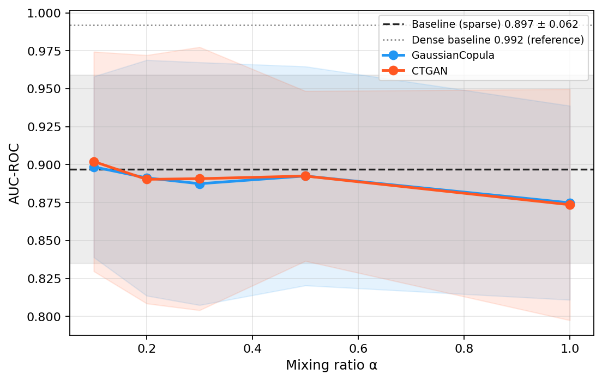

**Figure 3.** Augmentation U-curve for the sparsity stress test. The curve is flat across all α, so performance gaps driven by sparsity are not recoverable through synthetic augmentation.

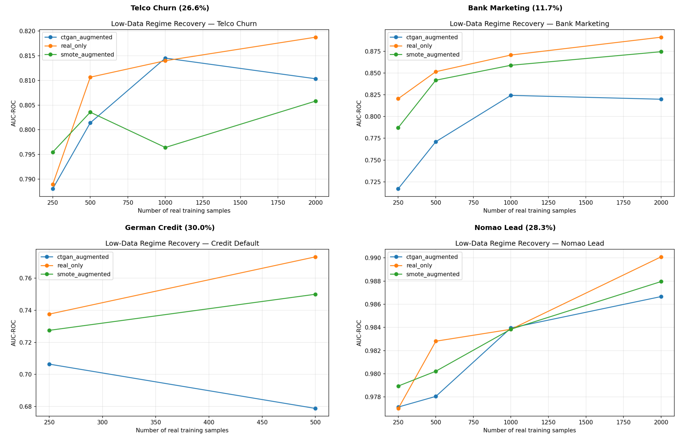

**Figure 4.** Low-data regime: AUC against real training set size for the control datasets. Augmentation recovers 30% to 60% of the performance gap at n=250 and the benefit narrows rapidly by n≥1,000. This is a second, independent line of evidence that augmentation value depends on how much real minority-class data is available, whichever generator is used.

**Marketing datasets with extreme imbalance.** On Hillstrom the baseline AUC is 0.548 ± 0.092, CTGAN reaches 0.605 ± 0.073, a gain of 5.75 points, and SMOTE reaches 0.606 ± 0.087, a gain of 5.84 points. On Criteo the baseline AUC is 0.846 ± 0.228, CTGAN reaches 0.974 ± 0.036, a gain of 12.87 points, and SMOTE reaches 0.966 ± 0.026, a gain of 11.99 points. Augmented confidence intervals are substantially narrower than the baseline, so synthetic augmentation under extreme imbalance stabilizes learning as well as improving its mean (Figure 5). These are mean gains. With 5 seeds, the 95% CI of the seed-paired gain includes zero for every method in Table 4 except GReaT, so no single gain is established on its own. The evidence for the regime-level pattern is the contrast with the control datasets and the dose-response experiments.

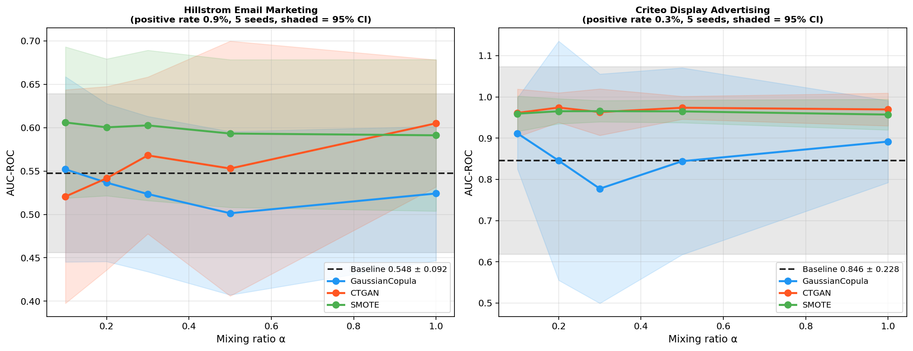

**Figure 5.** Augmentation U-curves for Hillstrom and Criteo with 95% CI bands. The steep rise from α=0 to about α=0.2 and the narrower CI bands after augmentation are the main visual evidence for both the headline gain and the variance-stabilization finding.

**Multi-classifier robustness over 10 seeds.** On Criteo, the MLP fails to converge on real data alone in 7 of 10 seeds, with AUC below 0.15. With CTGAN augmentation all seven failed seeds recover, and all 10 seeds reach AUC between 0.865 and 0.986. The CTGAN advantage holds across Gradient Boosting at +12.04 points and Random Forest at +9.55 points. Logistic Regression is insensitive because its baseline is near ceiling at 0.963 (Figures 6 and 7).

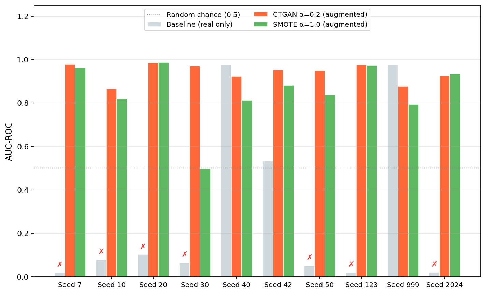

**Figure 6.** MLP per-seed AUC on Criteo for the real-only baseline, CTGAN at α=0.2 and SMOTE at α=1.0. A red cross above a baseline bar marks a seed that failed to converge on real data alone, defined as AUC below 0.15. All seven such seeds reach AUC above 0.86 after CTGAN augmentation.

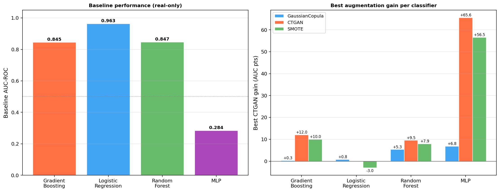

**Figure 7.** Multi-classifier robustness on Criteo across all four classifier families. The CTGAN advantage is not an artifact of choosing Gradient Boosting as the primary classifier.

**TabDDPM versus CTGAN at two training budgets.** At the default number of training iterations, N_iter=2,000, and at a fivefold extension to N_iter=10,000, CTGAN outperforms TabDDPM on both datasets. Extended training widens the gap rather than closing it, and TabDDPM at 10k goes uniformly negative on Hillstrom. In a paired t-test over seeds that compares the best-α CTGAN run with the best-α TabDDPM run, the difference at the default 2,000 iterations is +4.40 points on Hillstrom (d_z=1.07, p=0.076) and +2.96 points on Criteo (d_z=1.17, p=0.058). At 10,000 iterations it is +7.76 points on Hillstrom (d_z=1.25, p=0.049) and +6.41 points on Criteo (d_z=0.73, p=0.179) (Figure 8).

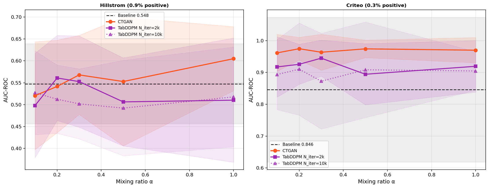

**Figure 8.** CTGAN versus TabDDPM at two training budgets. Extended training, shown dashed, widens rather than closes the CTGAN advantage, and all five TabDDPM-10k α values fall below baseline on Hillstrom.

**Does augmentation with GReaT help at all?** A directional positive signal at small n on Hillstrom, with 4 of 5 seeds winning at n=50, decays and inverts to a robustly negative effect at n=2,000, where 0 of 5 seeds win, with p=0.001 and p_fdr=0.008 in a paired t-test against the baseline. This is the only FDR-significant individual comparison in the study. GReaT actively hurts as training size grows, the opposite of every other method tested. Replicating with Mistral-7B, which has 7B parameters against 117M for GPT-2, does not change the outcome once gain is computed against each backbone's own seed-matched baseline. Mistral-7B underperforms its own baseline at every n tested on Telco, by −4.70 to −1.99 points, still hurts on anonymized features in German Credit, and has a best Hillstrom gain of +1.20 points over 3 of 5 valid seeds that remains well below CTGAN. Scaling the backbone 60-fold, from GPT-2 to Mistral-7B, does not rescue GReaT on any of the three datasets tested. The limitation of GReaT is that it samples unconditionally, similar to TabDDPM and GaussianCopula, so it does not enrich the minority class regardless of the raw capability of the large language model (Figure 9).

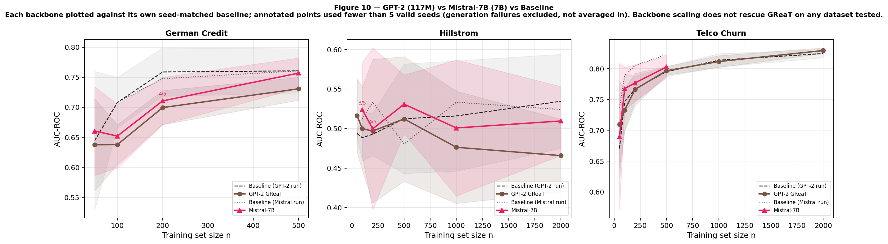

**Figure 9.** GPT-2 and Mistral-7B against baseline on three datasets, each backbone plotted against its own seed-matched baseline. Labels such as 3/5 mark points that used fewer than 5 valid seeds, because generation failures were excluded rather than averaged in. Backbone scaling does not rescue GReaT on any dataset tested.

### 3.4. Method-Wise Average Performance and the Missing-Baseline Comparison

**Table 4. All evaluated methods, best-α gain in AUC points (pts) with the 95% CI of the seed-paired gain on each dataset separately, from 5 seeds. A single blended average across datasets is avoided because it would discard the uncertainty on each estimate.**

| Method | Cost | Hillstrom gain (95% CI) | Criteo gain (95% CI) |
|---|---|---|---|
| CTGAN | GPU/CPU, ~2 min/seed | +5.75 ± 6.06 pts | +12.87 ± 22.21 pts |
| ADASYN | Free, instant | +5.80 ± 7.09 pts | +12.35 ± 22.20 pts |
| SMOTE | Free, instant | +5.84 ± 10.64 pts | +11.99 ± 22.63 pts |
| Borderline-SMOTE | Free, instant | +1.13 ± 10.39 pts | +11.34 ± 21.95 pts |
| TabDDPM (2k) | GPU, ~6 min/seed | +1.35 ± 4.64 pts | +9.91 ± 22.96 pts |
| Random undersampling | Free, instant | +2.11 ± 8.87 pts | +7.24 ± 21.55 pts |
| GaussianCopula | CPU, ~seconds | +0.44 ± 7.92 pts | +6.61 ± 23.66 pts |
| `class_weight='balanced'` | Free, instant | −1.80 ± 6.66 pts | +5.32 ± 24.10 pts |
| **GReaT (GPT-2), n=2,000*** | GPU, ~5 min/seed | **−6.87 pts** (0/5 seeds win, p_fdr=0.008) | *not evaluated on Criteo* |

*GReaT's protocol varies training-set size n at fixed α=1.0, whereas every other method varies α at fixed n=10,000. Its number is therefore not on the same axis as the rest of the table and is included for visibility, not for direct ranking. At its largest tested n of 2,000, the condition most comparable to the full-data condition of the other methods, GReaT is the only method in this study to deliver a statistically significant, FDR-corrected effect, and that effect is harmful. At every other n tested on Hillstrom, GReaT's gain ranges from +2.25 points at n=50 down to this value and never exceeds the performance of TabDDPM or GaussianCopula at any n (Section 3.3).

Confidence intervals overlap substantially at the top of Table 4. The wide intervals on Hillstrom, which follow from only about 72 real minority examples per split (Section 4.1), mean that the gains of CTGAN, ADASYN and SMOTE cannot be distinguished by eye. A direct paired comparison confirms that this is more than an eyeballing artifact: ADASYN and CTGAN are statistically indistinguishable in a paired t-test over seeds, with p=0.970 on Hillstrom and p=0.212 on Criteo. This agrees with evidence that balancing adds little for strong classifiers [47,48]. If a cheap method recovers most of the reported gain at zero cost, recommending the expensive one is the wrong advice. Figure 10 shows all methods side by side.

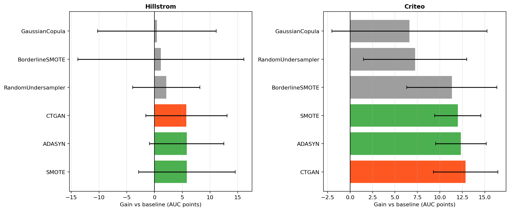

**Figure 10.** All evaluated methods on both marketing datasets, sorted by gain. Orange marks CTGAN, green marks the free methods that match it, and grey marks the rest. ADASYN's gain is within the 95% CI of CTGAN's on both datasets, and Borderline-SMOTE and random undersampling show smaller point-estimate gains at zero cost. Error bars are 95% CIs of the seed-paired gain.

### 3.5. Statistical Significance Analysis

We report paired t-tests with Benjamini-Hochberg FDR correction at q=0.10 over a family of 14 headline comparisons. Individual per-dataset comparisons show medium-to-large effect sizes, with Cohen's d_z from 0.62 to 1.18, but none reach FDR significance at 5 to 10 seeds. A paired t-test at 5 seeds reaches 80% power, meaning an 80% chance of detecting a true effect at the 5% significance level, only when d_z is at least about 1.7. The only individually FDR-significant comparison is GReaT harm at Hillstrom n=2,000, with p_fdr=0.008.

### 3.6. Precision-Recall Trade-Off and the Dose-Response Curve

**Threshold-based metrics diverge sharply by method (Table 5).** At the default 0.5 threshold, CTGAN, ADASYN, Borderline-SMOTE and GaussianCopula all collapse to F1=0 on Hillstrom, because the classifier never crosses the threshold into predicting the positive class at a 0.9% positive rate, while accuracy stays uselessly high at 98% to 99%. Random undersampling is the exception. It recovers 57% of positives on Hillstrom and 96% on Criteo, against 1% to 29% for every enrichment-based method, but precision collapses and accuracy falls to 51.1% on Hillstrom and 80.9% on Criteo. This is the expected effect of shifting the training-time class prior. It is a genuinely different operating point that a practitioner needing high recall, with tolerance for human review, might prefer.

**Table 5. Threshold-based metrics at the default 0.5 threshold on every dataset except the sparse stress test, mean over 5 seeds at the α that maximizes each method's mean AUC. The best F1, precision and recall in each column are in bold, with ties all in bold.**

**Table 5a. Hillstrom.**

| Method | F1 | Precision | Recall | Accuracy |
|---|---|---|---|---|
| Baseline | 0.012 | 0.013 | 0.011 | 98.4% |
| CTGAN | 0.000 | 0.000 | 0.000 | 98.9% |
| ADASYN | 0.000 | 0.000 | 0.000 | 99.0% |
| SMOTE | 0.014 | **0.018** | 0.011 | 98.6% |
| Borderline-SMOTE | 0.000 | 0.000 | 0.000 | 98.9% |
| GaussianCopula | 0.000 | 0.000 | 0.000 | 98.3% |
| Random undersampling | **0.022** | 0.011 | **0.572** | 51.1% |
| `class_weight='balanced'` | 0.018 | 0.010 | 0.094 | 90.3% |

**Table 5b. Criteo.**

| Method | F1 | Precision | Recall | Accuracy |
|---|---|---|---|---|
| Baseline | 0.259 | **0.312** | 0.240 | 99.6% |
| CTGAN | 0.214 | 0.264 | 0.184 | 99.6% |
| ADASYN | 0.225 | 0.198 | 0.273 | 99.4% |
| SMOTE | 0.180 | 0.133 | 0.291 | 99.2% |
| Borderline-SMOTE | **0.262** | 0.247 | 0.291 | 99.4% |
| GaussianCopula | 0.204 | 0.211 | 0.229 | 99.5% |
| Random undersampling | 0.032 | 0.016 | **0.960** | 80.9% |
| `class_weight='balanced'` | 0.094 | 0.067 | 0.167 | 99.1% |

TabDDPM (2k) is not shown in Tables 5a and 5b because its evaluation harness saved only AUC-ROC, F1 and Average Precision, and recomputing precision, recall and accuracy requires a GPU rerun with `synthcity` that was not performed. This is a narrower gap than for GReaT (Section 4.7), because F1 and AP are measured. The F1 of TabDDPM is 0.000 on Hillstrom, which matches the threshold-collapse pattern of the enrichment-based methods on this dataset, and 0.156 (95% CI ± 0.181) on Criteo, below CTGAN at 0.214 and ADASYN at 0.225, consistent with its lower AUC gain in Table 4.

**Table 5c. Telco Churn.**

| Method | F1 | Precision | Recall | Accuracy |
|---|---|---|---|---|
| Baseline | 0.574 | 0.650 | 0.513 | 79.7% |
| CTGAN | 0.578 | **0.658** | 0.515 | 80.0% |
| SMOTE | **0.591** | 0.613 | **0.571** | 79.0% |
| GaussianCopula | 0.572 | 0.657 | 0.507 | 79.9% |

**Table 5d. Bank Marketing.**

| Method | F1 | Precision | Recall | Accuracy |
|---|---|---|---|---|
| Baseline | 0.498 | 0.631 | 0.412 | 90.3% |
| CTGAN | 0.472 | 0.633 | 0.377 | 90.2% |
| SMOTE | **0.558** | 0.578 | **0.539** | 90.0% |
| GaussianCopula | 0.456 | **0.638** | 0.356 | 90.1% |

**Table 5e. German Credit.**

| Method | F1 | Precision | Recall | Accuracy |
|---|---|---|---|---|
| Baseline | 0.588 | 0.685 | 0.520 | 78.3% |
| CTGAN | 0.559 | 0.695 | 0.470 | 77.9% |
| SMOTE | **0.604** | 0.627 | **0.583** | 77.1% |
| GaussianCopula | 0.587 | **0.699** | 0.507 | 78.6% |

**Table 5f. Nomao.**

| Method | F1 | Precision | Recall | Accuracy |
|---|---|---|---|---|
| Baseline | **0.926** | **0.936** | 0.916 | 95.8% |
| CTGAN | **0.926** | 0.935 | 0.917 | 95.8% |
| SMOTE | **0.926** | 0.924 | **0.929** | 95.8% |
| GaussianCopula | 0.923 | 0.933 | 0.913 | 95.6% |

Only the baseline, CTGAN, SMOTE and GaussianCopula were run on the four control datasets. ADASYN, Borderline-SMOTE, random undersampling, class weighting and TabDDPM were evaluated only on Hillstrom and Criteo. On the controls, SMOTE gives the highest recall and F1 on Telco, Bank Marketing and German Credit at the cost of precision, and all methods are close to indistinguishable on Nomao, whose baseline is near ceiling.


**The dose-response curve tests whether the extreme-scarcity effect reflects minority count or dataset identity** by fixing total sample size and varying minority count alone. On Bank Marketing, gains are positive only at the lowest minority count tested, 16, where SMOTE gains +5.31 points with p=0.033. From a minority count of 64 onward they are significantly negative, down to −3.62 points with p<0.01 (Figure 11).

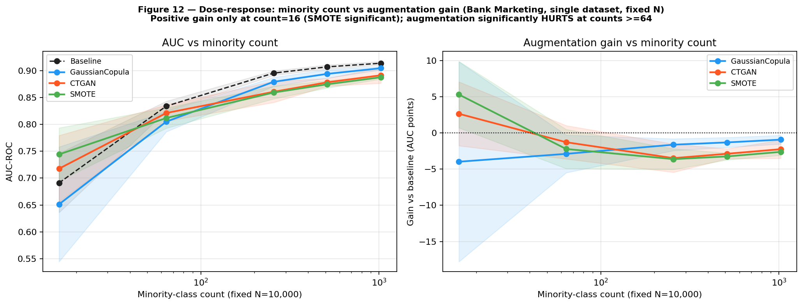

**Figure 11.** Bank Marketing dose-response, showing AUC and gain against minority count. Gain is positive only at the lowest count tested, and augmentation significantly hurts from a minority count of 64 onward. The decline holds smoothly across the whole range with no reversal. The count of 512 was added specifically to check for a reversal partway through, and there is none.

On Nomao, chosen for a different domain and for 119 features against 17 for Bank Marketing, the same direction holds: gains are large at the lowest counts, with CTGAN at +11.21 points and SMOTE at +16.83 points at a minority count of 16, and shrink as the count rises. At minority counts of 512 and 1,024 the harm is an order of magnitude smaller than on Bank Marketing, from −0.09 to −0.31 points for GaussianCopula and CTGAN. Nomao's baseline is already near ceiling, with AUC above 0.97 by a minority count of 256, which leaves little room to move (Figure 12).

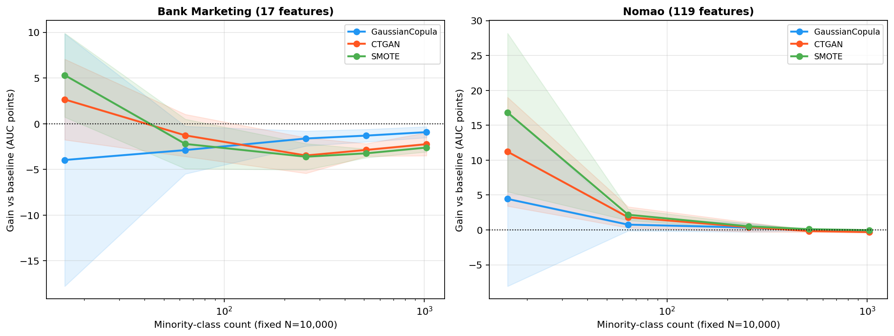

**Figure 12.** Dose-response replication, Bank Marketing beside Nomao. Both show the same qualitative direction, with gains shrinking as count rises, but at different thresholds and severity. Nomao's near-ceiling baseline leaves little room to move in either direction.

Overlaying both curves on the original six-dataset comparison shows that each curve's endpoint converges toward that dataset's own cross-dataset point, which is an internal consistency check between two independently run analyses (Figure 13).

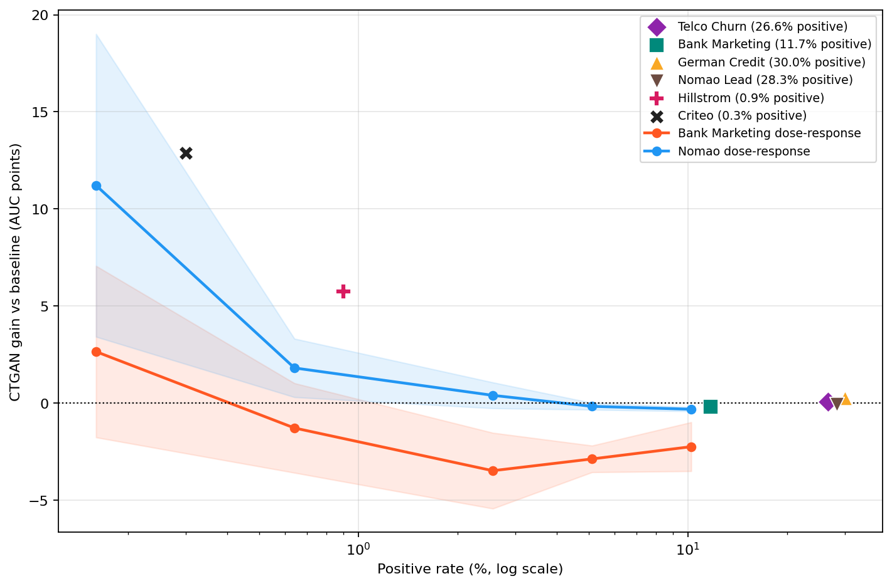

**Figure 13.** CTGAN gain against positive rate. Sparse cross-dataset points, shown as one marker and legend entry per dataset, are overlaid with the two dense within-dataset dose-response curves. This is the central figure for which positive-rate range shows value and which does not. It shows diminishing and then reversing returns as positive rate rises, replicated within two datasets and not only suggested by six sparse cross-dataset points.

**Table 6. Dose-response summary, showing CTGAN gain in AUC points against minority count on both datasets, with paired t-test p-values.**

| Minority count | Positive rate | Bank Marketing gain | Nomao gain |
|---|---|---|---|
| 16 | 0.16% | +2.65 pts (p=0.171) | +11.21 pts (p=0.016) |
| 64 | 0.64% | −1.28 pts (p=0.198) | +1.81 pts (p=0.029) |
| 256 | 2.56% | −3.48 pts (p=0.008) | +0.40 pts (p=0.169) |
| 512 | 5.12% | −2.87 pts (p<0.001) | −0.16 pts (p=0.059) |
| 1,024 | 10.24% | −2.24 pts (p=0.008) | −0.31 pts (p=0.001) |

---

## 4. Discussion

### 4.1. Why Minority-Example Scarcity Is the Mechanism

The results trace a clean dichotomy at the cross-dataset level. On datasets with positive rates between 11.7% and 30.0%, the best augmentation gain is +0.27 AUC points, while on datasets at 0.9% and 0.3% the same generators deliver mean gains of +5.7 to +12.9 AUC points. We interpret this through the minority-example budget. At a 0.3% positive rate and an 8,000-row training set only about 24 minority examples are expected, and the variance of this count across seeds is the source of the wide baseline confidence intervals, ±22.8 AUC points on Criteo. Synthetic augmentation densifies the minority-class region of feature space. CTGAN, SMOTE and ADASYN all do this directly, though by different mechanisms. SMOTE interpolates within the convex hull of observed minority examples without consulting the majority class, which can leave it blind to the boundary and prone to near-duplicate samples when minority seeds are few [38]. CTGAN conditions on the class label while preserving cross-feature correlations, which in principle makes its minority samples more aware of where the class boundary lies [39]. GaussianCopula and unconditional TabDDPM sample in proportion to the existing imbalance and cannot densify the minority class.

### 4.2. Deep Learning Methods' Performance Is Not Uniquely Strong

This finding is consistent with the broader tabular-data literature, where tree-based models are repeatedly shown to match or outperform deep learning approaches [40,41]. TabDDPM, the strongest generator on general benchmarks [15], underperforms CTGAN in this regime by 3.0 to 4.4 AUC points at the default budget and falls further behind with five times more training. That pattern is inconsistent with undertraining and consistent with an architectural explanation, in which unconditional sampling cannot be fixed by more compute and needs a conditioning mechanism. It also agrees with prior comparative work that finds TabDDPM competitive at moderate imbalance but conditional generators advantageous under extreme scarcity [42,43]. The failure of GReaT comes from the framework and holds across both backbones. Scaling from GPT-2 at 117M parameters to Mistral-7B at 7B, which is 60 times larger, does not change the outcome on any of three datasets once gains are computed against each backbone's own seed-matched baseline. The missing-baseline comparison in Section 3.4 extends the theme. CTGAN is not uniquely capable of delivering the headline effect, since ADASYN, a heuristic from 2008, statistically ties it.

### 4.3. Evaluation Metrics and Operational Considerations

AUC-ROC and threshold-based metrics such as F1, precision and recall diverge sharply in this regime (Section 3.6), and the divergence is informative. Augmentation improves the classifier's ability to rank positives above negatives without necessarily shifting enough probability mass across a fixed 0.5 threshold to change count-based predictions. We did not tune the decision threshold, and threshold moving remains a promising, untested, zero-cost extension. Compute cost varies by three orders of magnitude across the evaluated methods, from seconds for SMOTE and ADASYN, through about 2 minutes per seed on CPU for CTGAN, to 6 to 29 minutes per seed on GPU for TabDDPM and about 5 to 30 minutes per seed on GPU for GReaT. The ranking in Table 4 does not capture this dimension on its own, and it should weigh heavily in a practitioner's choice given how close the top three methods are on raw gain.

**Which mixing ratio α is best?** A consistent secondary observation across every augmentation sweep (Figures 2 and 5) is the location of the α* peak. On the four control datasets, the best gain, to the extent any gain is observable at all, occurs at α of 0.1, 0.2 or 0.3 on every dataset and degrades toward α=1.0. On the marketing datasets, CTGAN peaks at α=1.0 on Hillstrom but at α=0.2 on Criteo, and SMOTE peaks at α=0.1 on Hillstrom and α=0.3 on Criteo. The exact optimum is therefore dataset- and generator-specific, and an exhaustive grid search is unnecessary. A 5-point sweep over α ∈ {0.1, 0.2, 0.3, 0.5, 1.0} is sufficient to locate the optimum within a 0.1 step in every case tested. We interpret the U-shape as a quality-quantity trade-off. Moderate synthetic volume densifies the minority-class region without overwhelming the real-data signal, while at high volume the imperfect fidelity of the synthetic rows begins to bias the decision boundary. Our practical guidance is to start at α between 0.1 and 0.3 and not at 1.0, whichever generator is chosen.

### 4.4. Model-Specific Observations

Random undersampling is the clearest example of a method whose behavior cannot be summarized by AUC gain alone (Section 3.6). It is not competitive on F1 or precision but delivers the highest recall of any method by a wide margin, which makes it a viable option for high-recall, human-reviewed use cases. GaussianCopula fails for a structural reason. It samples at the natural class rate by design, so no amount of α-tuning changes its inability to enrich the minority class.

### 4.5. A Self-Disclosed Reliability Limitation: CTGAN's Uncontrolled Fit-to-Fit Variance

Unlike TabDDPM and GReaT, which both seed PyTorch and CUDA through a `seed_everything()` routine, the CTGAN-calling code in this study never calls `torch.manual_seed()` and seeds only NumPy's RNG. We confirmed empirically that this matters. With input data, split and NumPy seed fully fixed, four repeated CTGAN fits produced downstream AUC ranging from 0.527 to 0.632, a 10.45-point range and noise of the same size as the largest augmentation gains reported here. GaussianCopula is unaffected, since it is fully deterministic under the same test and has no PyTorch dependency. This mirrors a broader, documented problem in ML benchmarking, where insufficient seed control can inflate apparent method differences [44]. Every CTGAN confidence interval reported here should therefore be read as a lower bound on the true uncertainty. We did not rerun the affected experiments with corrected seeding. The fix is straightforward, adding `torch.manual_seed(seed)` before each fit, but rerunning is computationally expensive. We disclose the issue in line with broader calls for transparent reporting of synthetic-data methodology risks [45]. To our knowledge this reliability gap has not been reported before, and it likely affects prior CTGAN benchmarks generally.

### 4.6. Practical Implications and Decision Framework

**Table 7. Practitioner decision guide.**

| Positive rate | Observed pattern | Recommendation |
|---|---|---|
| > 10% | No generator gained more than 0.27 AUC points | Skip augmentation |
| 1%–10% | Tested directly on two datasets: significantly harmful on one, negligible on the other | Validate on your own data, since the two datasets tested here disagree |
| 0.5%–1% | ADASYN/SMOTE/CTGAN tied, +5–6 AUC points | Try ADASYN or SMOTE first (free) |
| < 0.5% | ADASYN/SMOTE/CTGAN tied, +12–13 AUC points | Try ADASYN or SMOTE first; reserve CTGAN for cases where they underperform on your data |

**GReaT is not recommended in any positive-rate band tested.** It never wins at any n tested against CTGAN, ADASYN or SMOTE, its best-case gain is small and non-significant, and its worst case at large n is the only statistically significant harm in the entire study. Scaling the backbone from GPT-2 to Mistral-7B does not change this. GReaT is included to answer whether LLM-based synthesis is competitive in this regime, not because it is a candidate recommendation, and the answer is that it is not (Sections 3.3 and 4.2).

### 4.7. Limitations

**Dataset breadth and scope.** All experiments use at most 15,000 rows, with 10,000 for Nomao and the marketing datasets, so the conclusions apply to the data-scarce minority-class regime this defines and not necessarily to full-scale industrial datasets such as the full 64,000 rows of Hillstrom or the 13.9M rows of Criteo. The main experiments use a single fixed holdout per dataset, whereas the dose-response design uses a single large fixed holdout by construction. Generator hyperparameters are library defaults throughout, except in the TabDDPM training-budget comparison. F1, precision, recall and accuracy are not computed for GReaT, because its harness captured only AUC-ROC and a statistically meaningful estimate would require rerunning the full multi-seed, multi-backbone matrix, given GReaT's own documented per-seed fit variance. This does not weaken the GReaT conclusion, which rests on the sampling-mechanism argument in Sections 4.1 and 4.2 and is metric-agnostic. Precision, recall and accuracy are also not computed for TabDDPM (Table 5). That gap is narrower, since F1 and Average Precision are already measured, and the remaining three metrics would need a GPU rerun that was not performed. Privacy is not evaluated. SMOTE-family methods generate near-duplicates of real minority examples, which raises membership-inference risk, and practitioners in regulated environments such as GDPR and CCPA settings should run distance-to-closest-record and membership-inference checks before deployment [46]. Multi-dimensional statistical fidelity, covering marginal similarity, correlation preservation and KS tests in the framework of Won et al. [17], is not measured beyond the targeted class-distribution check in Section 3.2, and a full fidelity-utility analysis on this dataset suite is left to future work. Finally, the uncontrolled fit-to-fit variance of CTGAN (Section 4.5) is disclosed but not corrected.

---

## 5. Conclusions

We tested whether minority-example scarcity is the strongest observed correlate of synthetic augmentation value in tabular classification, extending the closest prior benchmark at this venue [17] along five of its own six stated limitations. Across six datasets, five generators and two independent dose-response experiments, scarcity is a real and replicated driver of augmentation value, but neither the exact threshold nor the severity of crossing it is a portable constant across datasets. The more consequential finding for practitioners is that CTGAN is not uniquely capable of delivering the effect this literature documents, since ADASYN and SMOTE, both free, tie it directly. We also identify and disclose an uncontrolled reliability gap in the standard CTGAN implementation that, to our knowledge, has not been reported before. Future work should extend the dose-response design to more datasets to establish whether room to improve, meaning baseline separability, is a more fundamental moderator than minority count alone. It should also apply the multi-dimensional fidelity framework of Won et al. [17] to this dataset suite, to test the fidelity-utility trade-off their study identifies against the enrichment mechanism identified here.

---

## Author Contributions

Conceptualization, methodology, software, validation, formal analysis, investigation, data curation, writing (original draft preparation), writing (review and editing), and visualization, all authors. All authors have read and agreed to the published version of the manuscript.

## Funding

This research received no external funding.

## Institutional Review Board Statement

Not applicable. This study used only publicly available, de-identified tabular datasets and involved no human participants or animals.

## Informed Consent Statement

Not applicable. The study used only publicly available, de-identified data, and no participants were recruited.

## Data Availability Statement

All datasets used are publicly available: Hillstrom (MineThatData), Criteo (Criteo AI Lab uplift dataset), Telco Customer Churn (IBM/Kaggle), Bank Marketing (UCI ML Repository), German Credit (OpenML id=31), and Nomao (OpenML id=1486). The code, experiment scripts and raw result files are available from the corresponding author upon reasonable request.

## Conflicts of Interest

The authors declare no conflicts of interest.

---

## Abbreviations

The following abbreviations are used in this manuscript.

- ADASYN: Adaptive Synthetic Sampling
- AP: Average Precision
- AUC (AUC-ROC): area under the receiver operating characteristic curve
- CDF: cumulative distribution function
- CI: confidence interval
- CTGAN: Conditional Tabular Generative Adversarial Network
- FDR: false discovery rate
- GAN: generative adversarial network
- GReaT: Generation of Realistic Tabular data
- KS: Kolmogorov-Smirnov
- LLM: large language model
- MLP: multi-layer perceptron
- SDV: Synthetic Data Vault
- SMOTE: Synthetic Minority Over-sampling Technique
- TabDDPM: tabular denoising diffusion probabilistic model
- TSTR: train on synthetic, test on real
- TVAE: tabular variational autoencoder
- UCI: University of California, Irvine (Machine Learning Repository)

---

## Appendix A. Experimental Configuration

See the generator and classifier hyperparameter tables in the companion analysis document (`paper2-empirical.md`, Sections 3.2 to 3.4) for the complete configuration. It is reproduced there in full rather than duplicated here, to avoid drift between the two documents.

## Appendix B. Evaluation Metrics Definitions

Let $TP, FP, TN, FN$ denote confusion-matrix counts at the classifier's default 0.5 decision threshold, and let $\hat{y} \in [0,1]$ be the classifier's predicted probability for the positive class.

**Precision, Recall, Accuracy, F1 (minority class):**

$$P = \frac{TP}{TP+FP}, \qquad R = \frac{TP}{TP+FN}, \qquad \mathrm{Acc} = \frac{TP+TN}{TP+FP+TN+FN}, \qquad F_1 = \frac{2PR}{P+R}.$$

**AUC-ROC** (threshold-independent): the probability that a randomly drawn positive example is ranked above a randomly drawn negative example,

$$\mathrm{AUC} = \Pr(\hat{y}_i > \hat{y}_j \mid y_i = 1,\ y_j = 0).$$

**Average Precision (AP)** is the area under the precision-recall curve, $\mathrm{AP} = \sum_k (R_k - R_{k-1})\  P_k$, summed over the ranking-induced sequence of thresholds $k$. $F_1$ is a single-threshold quantity while AP is threshold-aggregated, so the two are not interchangeable (Section 3.6). Neither can be recovered algebraically from the other or from AUC alone. The $F_1$ score has two degrees of freedom, $P$ and $R$, whereas AUC and AP each supply only one aggregate constraint across all thresholds and not a value at the specific 0.5 cut point.

**Cohen's $d_z$** (paired-samples effect size): for per-seed differences $\delta_s = \Delta_G(\alpha, s)$ across seeds $s=1,\dots,k$,

$$d_z = \frac{\bar\delta}{\mathrm{sd}(\delta)}, \qquad \bar\delta = \tfrac{1}{k}\sum_s \delta_s, \qquad \mathrm{sd}(\delta) = \sqrt{\tfrac{1}{k-1}\sum_s (\delta_s - \bar\delta)^2}.$$

**Minority-class count** $m$ is the absolute number of positive-class training examples in a split, as distinct from the positive rate $\pi = m/N$, which is a proportion. The dose-response design (Algorithm 1) is built to isolate exactly this distinction.

---

## References

1. Neslin, S.A.; Gupta, S.; Kamakura, W.; Lu, J.; Mason, C.H. Defection Detection: Measuring and Understanding the Predictive Accuracy of Customer Churn Models. *J. Mark. Res.* **2006**, 43, 204–211.
2. Johnson, J.M.; Khoshgoftaar, T.M. Survey on Deep Learning with Class Imbalance. *J. Big Data* **2019**, 6, 27.
3. He, H.; Garcia, E.A. Learning from Imbalanced Data. *IEEE Trans. Knowl. Data Eng.* **2009**, 21, 1263–1284.
4. Branco, P.; Torgo, L.; Ribeiro, R.P. A Survey of Predictive Modeling on Imbalanced Domains. *ACM Comput. Surv.* **2016**, 49, 31.
5. Jordon, J.; Szpruch, L.; Houssiau, F.; Bottarelli, M.; Cherubin, G.; Maple, C.; Cohen, S.N.; Weller, A. Synthetic Data — What, Why and How? *arXiv* **2022**, arXiv:2205.03257.
6. Fonseca, J.; Bacao, F. Synthetic Data Generation for Imbalanced Learning on Tabular Data. *Expert Syst. Appl.* **2023**.
7. Fernández, A.; García, S.; Herrera, F.; Chawla, N. SMOTE for Learning from Imbalanced Data: Progress and Challenges, Marking the 15-Year Anniversary. *J. Artif. Intell. Res.* **2018**, 61, 863–905.
8. Douzas, G.; Bacao, F. Geometric SMOTE: A Geometrically Enhanced Drop-in Replacement for SMOTE. *Inf. Sci.* **2019**, 501, 118–135.
9. Zhao, Z.; Kunar, A.; Van der Scheer, H.; Birke, R.; Chen, L.Y. CTAB-GAN: Effective Table Data Synthesizing. In Proceedings of the Asian Conference on Machine Learning (ACML), **2021**.
10. Shi, J.; Xu, M.; Hua, W.; Zhang, H.; Ermon, S.; Leskovec, J. TabDiff: A Mixed-Type Diffusion Model for Tabular Data Generation. In Proceedings of the International Conference on Learning Representations (ICLR), **2025**.
11. Zhao, Z.; Birke, R.; Chen, L. TabuLa: Harnessing Language Models for Tabular Data Synthesis. *arXiv* **2023**, arXiv:2310.12746.
12. Gulati, M.S.; Roysdon, P.F. TabMT: Generating Tabular Data with Masked Transformers. *NeurIPS* **2023**.
13. Solatorio, A.V.; Dupriez, O. REaLTabFormer: Generating Realistic Relational and Tabular Data using Transformers. *arXiv* **2023**, arXiv:2302.02041.
14. Erickson, N.; et al. TabArena: A Living Benchmark for Machine Learning on Tabular Data. *NeurIPS* **2025**.
15. Davila Restrepo, G.; et al. Benchmarking Tabular Data Synthesis: Evaluating Tools, Metrics, and Datasets on Prosumer Hardware. *Data Sci. J.* **2025**, 24, 37.
16. Sidorenko, A.; Platzer, M.; Scriminaci, M.; Tiwald, P. Benchmarking Synthetic Tabular Data: A Multi-Dimensional Evaluation Framework. *arXiv* **2025**, arXiv:2504.01908.
17. Won, D.-H.; et al. Synthetic Data Augmentation for Imbalanced Tabular Data: A Comparative Study of Generation Methods. *Electronics* **2026**, 15, 883.
18. Moro, S.; Cortez, P.; Rita, P. A Data-Driven Approach to Predict the Success of Bank Telemarketing. *Decis. Support Syst.* **2014**, 62, 22–31.
19. Hofmann, H. Statlog (German Credit Data); UCI Machine Learning Repository, **1994**.
20. Candillier, L.; Lemaire, V. Design and Analysis of the Nomao Challenge. In Proceedings of the ALRA Workshop, ECML-PKDD, **2012**.
21. Hillstrom, K. The MineThatData E-Mail Analytics and Data Mining Challenge. *MineThatData Blog*, **2008**.
22. Diemert, E.; Betlei, A.; Dieudonne-Boucher, C.; Amini, M.-R. A Large Scale Benchmark for Uplift Modeling. In Proceedings of the AdKDD & TargetAd Workshop, KDD, **2018**.
23. Agrawal, R.; Hamdare, S.; Ghosh, D.; et al. Improving Predictive Performance in Telecom Churn Modeling with Hybrid SMOTE and GAN-Based Synthetic Data Generation. *Int. J. Comput. Intell. Syst.* **2026**.
24. Guo, C.; Berkhahn, F. Entity Embeddings of Categorical Variables. *arXiv* **2016**, arXiv:1604.06737.
25. Chawla, N.V.; Bowyer, K.W.; Hall, L.O.; Kegelmeyer, W.P. SMOTE: Synthetic Minority Over-sampling Technique. *J. Artif. Intell. Res.* **2002**, 16, 321–357.
26. He, H.; Bai, Y.; Garcia, E.A.; Li, S. ADASYN: Adaptive Synthetic Sampling Approach for Imbalanced Learning. In Proceedings of the IEEE International Joint Conference on Neural Networks (IJCNN), **2008**; pp. 1322–1328.
27. Han, H.; Wang, W.-Y.; Mao, B.-H. Borderline-SMOTE: A New Over-Sampling Method in Imbalanced Data Sets Learning. In *Advances in Intelligent Computing (ICIC 2005)*; Lecture Notes in Computer Science, Vol. 3644; Springer: Berlin, Germany, **2005**; pp. 878–887.
28. Patki, N.; Wedge, R.; Veeramachaneni, K. The Synthetic Data Vault. In Proceedings of the IEEE International Conference on Data Science and Advanced Analytics (DSAA), **2016**; pp. 399–410.
29. Xu, L.; Skoularidou, M.; Cuesta-Infante, A.; Veeramachaneni, K. Modeling Tabular Data using Conditional GAN. *NeurIPS* **2019**.
30. Goodfellow, I.; Pouget-Abadie, J.; Mirza, M.; Xu, B.; Warde-Farley, D.; Ozair, S.; Courville, A.; Bengio, Y. Generative Adversarial Networks. *Commun. ACM* **2020**, 63, 139–144.
31. Kotelnikov, A.; Baranchuk, D.; Rubachev, I.; Babenko, A. TabDDPM: Modelling Tabular Data with Diffusion Models. In Proceedings of the International Conference on Machine Learning (ICML), **2023**.
32. Choi, W.C.; Lam, C.T.; Mendes, A.J. Comparison of Data Imputation Performance in Deep Generative Models for Educational Tabular Missing Data. In Proceedings of the International Conference on Educational Data Mining (EDM), **2025**; pp. 133–142.
33. Ho, J.; Jain, A.; Abbeel, P. Denoising Diffusion Probabilistic Models. In Proceedings of the 34th Conference on Neural Information Processing Systems (NeurIPS), **2020**; pp. 6840–6851.
34. Borisov, V.; Seßler, K.; Leemann, T.; Pawelczyk, M.; Kasneci, G. Language Models are Realistic Tabular Data Generators. In Proceedings of the International Conference on Learning Representations (ICLR), **2023**.
35. Boyd, K.; Eng, K.H.; Page, C.D. Area under the Precision-Recall Curve: Point Estimates and Confidence Intervals. In *Machine Learning and Knowledge Discovery in Databases*; Springer: Berlin, Germany, **2013**; pp. 451–466.
36. Friedman, J.H. Greedy Function Approximation: A Gradient Boosting Machine. *Ann. Stat.* **2001**, 29, 1189–1232.
37. Pedregosa, F.; et al. Scikit-learn: Machine Learning in Python. *J. Mach. Learn. Res.* **2011**, 12, 2825–2830.
38. Blagus, R.; Lusa, L. SMOTE for High-Dimensional Class-Imbalanced Data. *BMC Bioinform.* **2013**, 14, 106.
39. Engelmann, J.; Lessmann, S. Conditional Wasserstein GAN-Based Oversampling of Tabular Data for Imbalanced Learning. *Expert Syst. Appl.* **2021**, 174, 114582.
40. Shwartz-Ziv, R.; Armon, A. Tabular Data: Deep Learning is Not All You Need. *Inf. Fusion* **2022**, 81, 84–90.
41. Grinsztajn, L.; Oyallon, E.; Varoquaux, G. Why Do Tree-Based Models Still Outperform Deep Learning on Tabular Data? *NeurIPS* **2022**.
42. Gündüz, A.F.; Şahin, C.B. Synthetic Data Augmentation for Imbalanced Tabular Protein Subcellular Localization: A Comparative Study of SMOTE, CTGAN, TVAE, and TabDDPM Methods. *Appl. Sci.* **2026**, 16, 3694.
43. Adhikari, G.; Sapkota, A.; Acharya, J.; Ghimire, S.; Ghimire, U.K. A Comparative Analysis on Synthetic Data Generation of Electronic Health Records using CTGAN, REaLTabFormer and TabDDPM. *J. Innov. Eng. Educ.* **2026**, 9.
44. Bouthillier, X.; et al. Accounting for Variance in Machine Learning Benchmarks. In Proceedings of Machine Learning and Systems (MLSys), **2021**.
45. van Breugel, B.; Qian, Z.; van der Schaar, M. Synthetic Data, Real Errors: How (Not) to Publish and Use Synthetic Data. In Proceedings of the International Conference on Machine Learning (ICML), **2023**.
46. Lautrup, A.D.; Hyrup, T.; Zimek, A. SynthEval: A Framework for Detailed Utility and Privacy Evaluation of Tabular Synthetic Data. *Data Min. Knowl. Discov.* **2024**.
47. Elor, Y.; Averbuch-Elor, H. To SMOTE, or not to SMOTE? *arXiv* **2022**, arXiv:2201.08528.
48. Sakho, A.; Malherbe, E.; Scornet, E. Do We Need Rebalancing Strategies? A Theoretical and Empirical Study Around SMOTE and Its Variants. *arXiv* **2024**, arXiv:2402.03819.
49. Van Hulse, J.; Khoshgoftaar, T.M.; Napolitano, A. Experimental Perspectives on Learning from Imbalanced Data. In Proceedings of the 24th International Conference on Machine Learning (ICML), **2007**; pp. 935–942.
50. Drummond, C.; Holte, R.C. C4.5, Class Imbalance, and Cost Sensitivity: Why Under-Sampling Beats Over-Sampling. In Proceedings of the ICML Workshop on Learning from Imbalanced Datasets II, **2003**.
51. Elkan, C. The Foundations of Cost-Sensitive Learning. In Proceedings of the 17th International Joint Conference on Artificial Intelligence (IJCAI), **2001**; pp. 973–978.
